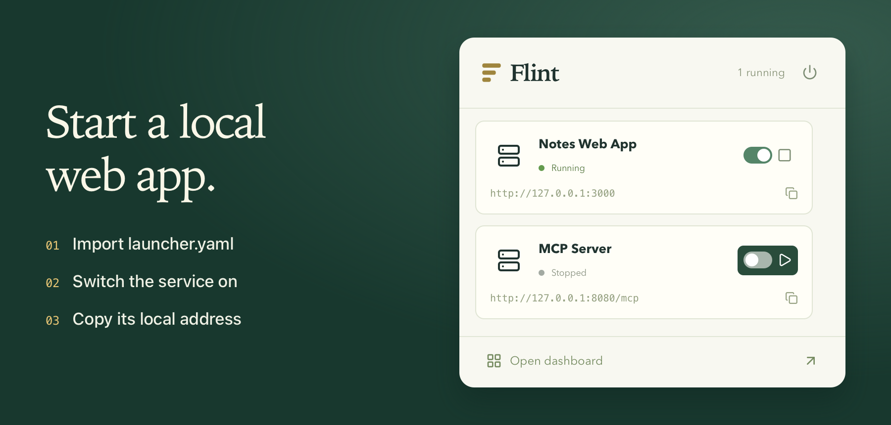

# Flint

Run web apps, HTTP APIs, and MCP servers on your own Mac. Add a project once, then use the menu bar to start it, check whether it’s running, or copy its local address.

[Download for Mac](https://github.com/puzihao2018/Flint/releases/download/v0.1.13/Flint-0.1.13-macOS-arm64.dmg) · [Try the interactive demo](https://zihaopu.cn/Flint/?lang=en) · [简体中文](docs/CN/README.md)



**Have a web app?** Import its `launcher.yaml`, or choose the project folder and enter its startup command once. Flint remembers the port and keeps the app running when you close the main window.

**Need a local tool?** Pick a supported release from the catalog. Flint installs its environment and lets you check its health and read its logs from the dashboard.

## Get Flint

**macOS 13+ · Apple Silicon · alpha.** Windows, Linux, and Intel Mac builds are not available yet.

[Download Flint 0.1.13 for macOS (DMG)](https://github.com/puzihao2018/Flint/releases/download/v0.1.13/Flint-0.1.13-macOS-arm64.dmg). Open the DMG and drag Flint into Applications. The [release page](https://github.com/puzihao2018/Flint/releases/tag/v0.1.13) includes the ZIP and SHA-256 checksums.

Builds are ad-hoc signed and **not Apple-notarized**. First-time MinerU setup downloads dependencies and models. See the [user guide](docs/EN/USER-GUIDE.md) for installation, compatibility, and removal details.

## Bring your app

To make your project importable, ship a [launcher.yaml](examples/python-webapp/launcher.yaml) with its startup command, port setting, and any install steps.

[Integration contract](docs/EN/COMMAND-CONTRACT.md) · [Guide for coding agents](docs/EN/AI-INTEGRATION.md) · [Node example](docs/EN/NODE-EXAMPLE.md) · [Python/uv example](docs/EN/PYTHON-EXAMPLE.md)

MinerU exposes an HTTP API, not MCP. Custom MCP support currently covers Streamable HTTP, not stdio or legacy SSE.

## Develop and contribute

On an Apple Silicon Mac, install Xcode Command Line Tools, Python 3.9+, Node.js 20.19+ (Node 24 recommended), and rustup. Rust is pinned in `rust-toolchain.toml`.

```sh
npm ci
FLINT_DATA_DIR=/tmp/flint-dev npm run desktop
npm test
npm run release:mac
```

[Contributing](docs/EN/CONTRIBUTING.md) · [Architecture](docs/EN/ARCHITECTURE.md) · [Validation](docs/EN/VALIDATION.md) · [Changelog](docs/EN/CHANGELOG.md) · [Website development](docs/EN/WEBSITE.md)

Flint is [MIT licensed](LICENSE). Third-party software and models retain their respective licenses; see [third-party notices](docs/EN/THIRD-PARTY-NOTICES.md).
