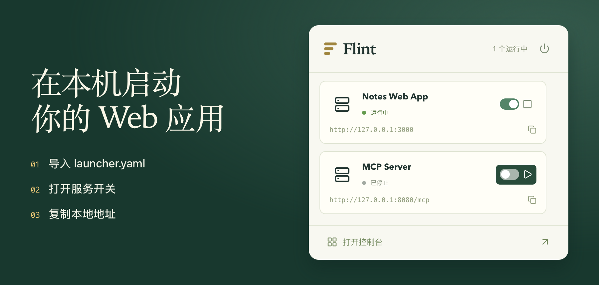

# Flint

在自己的 Mac 上运行 Web 应用、HTTP API 和 MCP 服务。项目只需添加一次，之后就能从菜单栏启停服务、查看运行状态、复制本地地址。

[下载 Mac 版](https://github.com/puzihao2018/Flint/releases/download/v0.1.13/Flint-0.1.13-macOS-arm64.dmg) · [试用交互演示](https://zihaopu.cn/Flint/?lang=zh-CN) · [English](../../README.md)



**已有 Web 应用？** 导入它的 `launcher.yaml`，或选中项目目录并填写一次启动命令。Flint 会记住端口，关闭主窗口后应用仍在后台运行。

**想安装本地工具？** 在应用市场选择支持的版本，由 Flint 安装独立环境。打开控制台就能检查服务是否就绪、查看运行日志。

## 获取 Flint

**macOS 13+ · Apple Silicon · alpha。** Windows、Linux 和 Intel Mac 暂未提供。

[下载 Flint 0.1.13（macOS DMG）](https://github.com/puzihao2018/Flint/releases/download/v0.1.13/Flint-0.1.13-macOS-arm64.dmg)，打开后将 Flint 拖入「应用程序」。ZIP 和 SHA-256 校验文件见[发布页](https://github.com/puzihao2018/Flint/releases/tag/v0.1.13)。

安装包采用 ad-hoc 签名，**尚未经过 Apple 公证**。首次部署 MinerU 需要下载依赖和模型。安装、兼容性与卸载说明见[使用指南](USER-GUIDE.md)。

## 接入你的项目

要让用户直接导入你的项目，请随项目提供 [launcher.yaml](../../examples/python-webapp/launcher.yaml)，写明启动命令、端口设置和必要的安装步骤。

[接入规范](COMMAND-CONTRACT.md) · [给编程 AI 的指南](AI-INTEGRATION.md) · [Node 示例](NODE-EXAMPLE.md) · [Python/uv 示例](PYTHON-EXAMPLE.md)

MinerU 提供 HTTP API，不是 MCP。自定义 MCP 服务目前支持 Streamable HTTP，不支持 stdio 和旧式 SSE。

## 开发与贡献

需要 Apple Silicon Mac、Xcode Command Line Tools、Python 3.9+、Node.js 20.19+（推荐 Node 24）和 rustup。Rust 版本由 `rust-toolchain.toml` 固定。

```sh
npm ci
FLINT_DATA_DIR=/tmp/flint-dev npm run desktop
npm test
npm run release:mac
```

[贡献指南](CONTRIBUTING.md) · [架构](ARCHITECTURE.md) · [验证范围](VALIDATION.md) · [更新记录](CHANGELOG.md) · [网站维护](WEBSITE.md)

源码采用 [MIT](../../LICENSE) 许可证。第三方软件与模型保留各自许可证，详见[第三方声明](THIRD-PARTY-NOTICES.md)。
